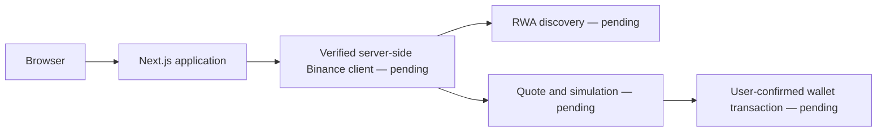

# First Bell

First Bell turns stock and portfolio investment intent into shareable links on BNB Chain. This repository currently contains the Phase 0 bootstrap. No live integrations or mainnet purchases are verified.

## Local setup

Use Node.js 22 or newer. Run `npm ci`, copy `.env.example` to `.env.local`, then run `npm run dev`. Check with `npm run typecheck` and `npm run build`.

Secrets stay server-side. Do not paste credentials in chat. The default mode is DRY_RUN with mainnet writes disabled. This build contains no broadcast implementation.

## Architecture

Bells will store tickers and basis-point weights; forks will be independent definitions with parent provenance. Autopilot will enforce deterministic contribution-first rules. These features are not implemented yet. BNB Chain is the mandated mainnet execution target; no token contracts are hard-coded.

See `CLAUDE.md` for scope, `docs/STATUS.md` for gates, `docs/API_VERIFICATION.md` for endpoint evidence, and `docs/DEVEX_RAW.md` for factual observations. Agentic Wallet, Agent Studio and B402 remain stretch items. Deployment, persistence, wallet connection, receipts, QR, live discovery, quotes, simulation and E2E testing remain incomplete.
