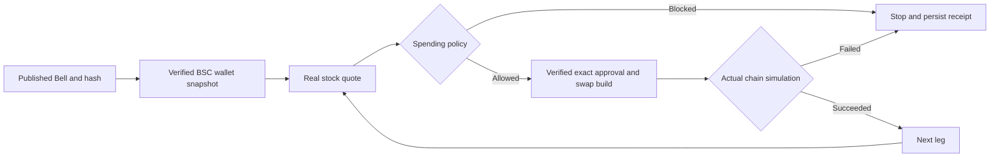

# Bell checks and real wallet holdings

The 2026-10-08 core update connects a published Bell to real BSC balances and real Binance quotes without spending funds. This follows the user's instruction to stay in paper trading until readiness. It does not pass the mandate's real-buy gate.

## User flow

1. Open a Bell, then **Check this Bell against a real wallet**.
2. Connect an EIP-1193 wallet on BSC and enter a budget.
3. First Bell snapshots USDT, native BNB, and the discovered curated stock contracts at one BSC block. It verifies contract code, symbols, and decimals. Missing or failed reads stop the check; they are not treated as zero balances.
4. Each leg uses the account's maximum-trade, minimum-reserve, and single-company-exposure policy. The route uses the available bStocks representation when discovered, otherwise another available discovered representation. This is an explicit default, not an economic ranking.
5. Obtain a real quote. A disallowed policy blocks the leg. An allowed leg builds and simulates the exact approval and swap against actual chain state. No approval is broadcast and no state override is used. A missing real allowance can therefore make swap simulation fail even when approval simulation succeeds.
6. Stop at the first blocked or failed leg. Preserve earlier simulations; leave later legs NOT_STARTED. Never sell to compensate.
7. Open the private, durable check receipt. It records the Bell version/hash, budget, wallet/block, allocation/reserve/rounding amounts, provider/route/quote, policy decision and actual simulation result when performed. All transaction hashes remain null.

The portfolio screen separately reads real wallet holdings. Paper balances and P&L remain separate. Real holdings have no invented cost basis or P&L.

## Boundaries

- Both new endpoints are read-only; neither accepts calldata nor broadcasts transactions, regardless of environment flags. Wallet connection is not an account-authentication claim or spending permission.
- Budget cap: 100 USDT per Bell check; 25 USDT per quoted leg. These are read-only caps, not live-trade authorization. The mandate's future live limit remains 5 USDT.
- Policies currently compare nominal USD micro-units. USDT is valued at $1; stock prices are indicative discovery prices. Tracked value excludes other contracts and BNB. This limited valuation scope appears in the UI.
- Gas balance is displayed, but no invented gas sufficiency rule is used. Fees/slippage are not modeled in the hypothetical allocation. The build validates its 0.5% slippage/minimum receive constraint. Reference-price semantics remain insufficient for an underlying-market-gap guard.
- Quotes use a local 15-second build freshness limit. This is not a provider expiry guarantee and cannot authorize future signing.
- Later legs are independent real simulations against existing chain state; this is not an atomic simulation of a hypothetically executed basket. Planned cash/exposure are updated only after a successful earlier simulation for policy budgeting.
- A browser session owns the check receipt. Repeated request IDs return the same check; changed instructions with the same ID return 409. Only one active check per account is allowed. Completed results survive application restart. An interrupted check expires after six minutes and requires a new manual check.
- Paper scheduling remains available. No mainnet scheduler, approval submission, swap signing, confirmation verifier, or verified post-purchase position is claimed by this release.

## Interfaces

- `POST /api/wallet/portfolio`: `{wallet}`; public-chain read with same-origin and rate-limit checks.
- `POST /api/execution`: `{requestId, bellId, wallet, amount}`; pins the published Bell and policy, persists CHECKING, and runs sequential checks after returning 202.
- `GET /api/execution/:id`: private progress/receipt; no-store.
- `/checks/:id`: private receipt view with progress polling.

SQLite `dry_receipts` lives in the existing protected shared database. No prepared calldata or API credential is stored in these receipts.

Automated coverage includes budget conservation, precise boundary decisions, failed-second-leg preservation, unexpected verification failure, and absence of transaction hashes. `scripts/check-bell-core.mjs` verifies the live deployment with an unfunded address, real quote, insufficient-funds policy, stopped later legs, idempotency, privacy, reload, wallet portfolio, mobile layout, and no signing/broadcast request.
